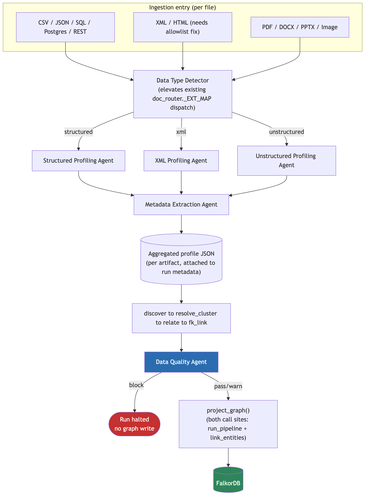
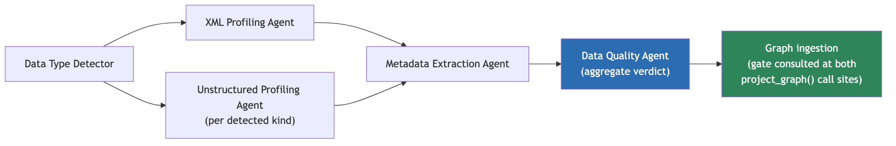

| | |
|---|---|
| **Status** | Design baseline, grounded in current code |
| **Prepared** | 2026-08-28 |
| **Scope** | New profiling-agent layer between entity resolution and the FalkorDB graph write |
| **Audience** | Executive Summary — business stakeholders. Sections 1–10 — engineering team. |
| **Codebase references** | `src/aryx/pipeline/orchestrate.py`, `src/aryx/connectors/*`, `src/aryx/pipeline/{profile,doc_discovery,clean_text,pii}.py`, `src/aryx/ontology/extract.py`, `src/aryx/profiler/`, `src/aryx/graph_profiler/` |

---

## Executive Summary

**What this is.** A new automated checkpoint for data quality, placed right before information is written into the company's knowledge graph. Today, structured data (spreadsheets, database tables, JSON) gets basic bookkeeping on the way in, but nothing actually stops broken, duplicated, or low-confidence data from reaching the graph. Documents and XML files have even less coverage — XML uploads are currently rejected outright, and the parser behind them has a known security gap.

**Why it matters.** The knowledge graph is the shared source of truth downstream reporting, entity resolution, and analytics all depend on. Without a quality gate, bad data silently propagates into that shared layer, and the cost of finding and fixing it later is much higher than catching it at the door. This project closes that gap without adding new infrastructure — no new services, no new operational overhead — by adding a small set of automated checks to the pipeline that already exists.

**What's being built.** Six small, independent "agents," each responsible for one concern:

| Agent | What it checks |
|---|---|
| Structured Data Profiling | Spreadsheets, database tables, JSON — reuses analytics already built |
| XML Profiling | Structure, nesting, repeated/missing elements, data types — new capability |
| Unstructured Data Profiling | Documents and text — type, language, length, entities, quality |
| Data Quality | Nulls, duplicates, malformed records, encoding issues, anomalies |
| Metadata Extraction | Source, file type, size, structure, timestamps, identifiers |
| Data Type Detector *(optional)* | Identifies incoming data and routes it to the right agent above |

Each agent produces the same simple report format, so results are consistent and easy to review regardless of what kind of data came in. If a serious problem is found (a required field is missing, sensitive data is detected, or the file is malformed), the run stops before anything reaches the graph — an ordinary quality warning does not.

**Status.** This document is the architecture baseline: what will be built, in what order, and how it will be tested. It has not yet been implemented. Section 10 lays out a minimal first version and its build order.

**How to read this document.** This summary is written for a non-technical audience. Engineering should continue to Section 1, which maps the design onto the actual codebase file-by-file.

---

## 1. Ingestion Flow Map

### 1.1 Where data enters today

There is no single "ingestion" entry point — there are two public APIs and, under them, per-type connectors:

| Path | Entry API | Dispatch | Connector(s) |
|---|---|---|---|
| **Structured** (CSV, JSON, SQL table, Postgres table, REST) | `POST /admin/ingest/file` (`file_ingest_api.py`), `POST /admin/docs/read` (`doc_discover_api.py`) | `.json`/`.csv` routed directly; `sql_source`/`postgres`/`rest_api` connectors are constructed programmatically, not via file upload | `CsvConnector`, `JsonConnector`, `SqlConnector`, `PostgresConnector`, `RestApiConnector`, `RecordsConnector` (`src/aryx/connectors/*.py`) |
| **XML** (`.xml`, `.html`, `.htm`) | *Not reachable* through either public API today | `doc_router.py::_EXT_MAP` already maps these extensions to `MarkupConnector`, but neither `doc_discovery.py::DOC_EXTS/DATA_EXTS` nor `file_ingest_api.py::_DATA_EXTS/_DOC_EXTS` include them, so an uploaded `.xml` file is rejected with HTTP 400 before it ever reaches the router | `MarkupConnector` (`src/aryx/connectors/markup.py`) — exists, wired at the router level, unreachable at the API level |
| **Unstructured documents** (PDF, DOCX, PPTX, images) | Both APIs | `DocumentRouterConnector` dispatches by suffix via `_EXT_MAP` | `PdfConnector`, `DocxConnector`, `PptxConnector`, `ImageConnector` |

All paths converge on `RawRecord`s: structured connectors emit one `RawRecord` per row/object; document connectors go through a different sub-path (`chunk_pages()` → `screen_chunks()` (PII) → `extract_mentions()`) before also producing `RawRecord`s. Both kinds are then handed to `discover()` → `run_spine()` (`src/aryx/pipeline/run.py`), which cleans, profiles (`ProfileAccumulator`), and lands them as `CleanRecord`s.

### 1.2 The point before data reaches the graph

`run_pipeline` (`src/aryx/pipeline/orchestrate.py`) chains: **discover → resolve_cluster → relate (optional) → fk_link (optional) → project**. `project` is the only stage that calls `project_graph()` (`src/aryx/project.py`), which does `graph.clear()` then writes nodes/edges to FalkorDB — the sole write path into the graph.

There is a second, easy-to-miss call site: `link_entities()` (`orchestrate.py`, ~line 242) invokes the same `project_graph()` a second time when FK links are resolved after the fact. **A gate placed only in `run_pipeline` is not watertight — it must wrap both call sites**, or a re-projection triggered by `link_entities()` can bypass it.

Separately, `src/aryx/profiler/` (dataset-level quality profiling, C03) and `src/aryx/graph_profiler/` (graph-shape profiling, C06) already exist and already compute much of what's being asked for here (type inference, quality flags, roles, stats) — but both are invoked from `src/aryx/pipeline/downstream.py::run_downstream()`, which wraps every call in `try/except Exception: log.warning(...)`. **Today, nothing profiling-related can block a graph write — everything runs best-effort, and only after `project` has already fired.** This is the core gap: the analytics mostly exist; the *gate* does not.

### 1.3 Where the EDA/profiling agents should trigger

Two trigger points, not one, because they answer different questions:

1. **Per-artifact, at ingestion time** (inside `DocumentRouterConnector.extract()` for documents, or immediately after a structured connector's `extract()`/`clean()` pass) — this is where type detection, XML structural profiling, unstructured document profiling, and metadata extraction naturally run, because they need the raw file/chunk, not the resolved entity graph. Output attaches to the run as artifact-level metadata.
2. **Once, as a blocking gate, immediately before each `project_graph()` call** (`orchestrate.py` line ~206 and inside `link_entities()`) — this is where the Data Quality Agent's aggregate verdict is evaluated and a `block`-severity result halts the run before any FalkorDB write, exactly as the existing `resolve_cluster`/`relate`/`fk_link` stages already halt on failure via `runner.stage(...)`.



---

## 2. Agent Responsibilities

All agents share one interface (Section 3) and are independently callable/testable modules — never inline logic buried in a connector or in `orchestrate.py` (Section 7).

### 2.1 Structured Data Profiling Agent

**Reuses, does not rebuild.** `src/aryx/pipeline/profile.py::ProfileAccumulator` already computes non-null/distinct/sample stats inline during `run_spine()`; `src/aryx/profiler/profile.py::profile_dataset` already computes the richer layer this agent needs — canonical type inference, analytical role (`identifier`/`measure`/`dimension`/`time`/`status`/`attribute`), and quality flags (`missing_values`, `constant`, `high_cardinality`, `mixed_types`, `outliers`). Today `profile_dataset` runs post-hoc and non-blocking via `run_downstream()`.

- **Inputs:** landed `CleanRecord`s for the run (same input `ProfileAccumulator` already sees), or a dataset snapshot (same input `profile_dataset` already takes).
- **Change required:** expose `profile_dataset`'s output synchronously to the new gate, and add a severity mapping (e.g. `constant`/`mixed_types` on a required field → `block`; `high_cardinality`/`outliers` → `warn`) — the profiling logic itself does not need to be rewritten.
- **Output:** standardized JSON (Section 3), `source.type = "structured"`.

### 2.2 XML Profiling Agent

New — the current XML path (`markup.py::_extract_xml`) discards structure entirely; it flattens every element into `"tag: text"` lines before anything downstream sees it. See Section 4 for the build plan.

- **Inputs:** raw XML bytes/parsed tree, prior to (or alongside) the existing flattening pass.
- **Output:** schema/tag-path map, nesting depth, repeated-element counts, optional/missing-node flags, inferred per-path data types, malformed-XML flags. Standardized JSON, `source.type = "xml"`.

### 2.3 Unstructured Data Profiling Agent

New — operates on `DocumentChunk`s (`src/aryx/pipeline/clean_text.py::chunk_pages()` output), after PII screening (`pii.py::screen_chunks`), before or alongside `ontology/extract.py::extract_mentions`.

- **Inputs:** `list[DocumentChunk]` for one document, plus the format the connector already determined (`PdfConnector`/`DocxConnector`/`PptxConnector`/`ImageConnector`/`MarkupConnector`).
- **Output:** document/file type, text length stats, language, lightweight entity/keyword signal (reuse the spaCy model already loaded for Presidio in `pii.py::_engines()` for cheap NER rather than invoking `extract_mentions`'s LLM call twice), document section/structure hints (from page/slide boundaries already present in `DocumentChunk.page_slide`), near-duplicate detection across chunks (simhash/minhash over chunk text), missing/corrupted-content flags (e.g. all-OCR-noise, zero extracted text). Standardized JSON, `source.type = "unstructured"`.

### 2.4 Data Quality Agent

The aggregate gate-facing agent — the one whose verdict actually blocks a `project_graph()` call (Section 1.3, trigger point 2).

- **Inputs:** the aggregated per-artifact outputs from 2.1–2.3 for the run, plus a direct pass over landed `CleanRecord`s for record-level checks the per-field profilers don't already cover: null-rate thresholds, duplicate-record detection (hash of normalized payload), malformed-record detection (schema/required-field violations), encoding issues (mojibake/invalid-UTF-8 detection on raw text fields), and anomaly flags carried up from 2.1–2.3.
- **Output:** standardized JSON with `recommended_next_action ∈ {proceed, warn, block}` — this is the value the orchestration layer (Section 6) reads to decide whether to call `project_graph()`.

### 2.5 Metadata Extraction Agent

Runs alongside 2.1–2.3 for every artifact — cheap, always-on, never blocks.

- **Inputs:** file path/bytes, `SourceRef` (already attached to every `RawRecord`/`DocumentChunk`), dataset registration info (`register_dataset` in `file_ingest_api.py`).
- **Output:** source system/dataset, file type, byte size, schema/structure summary (column list for structured; tag-path summary for XML; section list for documents), timestamps (file mtime, ingestion time), identifiers (`doc_id` sha256 for documents — already computed in `doc_router.py::ingest_document`; a stable content hash for structured files, computed the same way).

### 2.6 Data Type Detector (optional, first in the chain)

Not a new algorithm — an explicit, testable elevation of dispatch logic that already exists split across two places (`doc_router.py::_EXT_MAP`, `doc_discovery.py::DOC_EXTS/DATA_EXTS`). Consolidating it into one component makes it independently unit-testable and gives the orchestration layer one place to ask "what kind of thing is this?" instead of re-deriving the answer from allowlist membership at each call site.

- **Inputs:** file path/extension, optionally a content sniff (magic bytes) for mislabeled extensions.
- **Output:** `DataKind ∈ {structured, xml, unstructured, unknown}`, routed to the matching agent from 2.1–2.3.

---

## 3. Standardized Agent Output Contract

Every agent (2.1–2.6) returns the same JSON shape, regardless of what it profiles. This is what makes the orchestration layer's aggregation step (Section 6) generic instead of per-agent-type logic.

```json
{
  "agent": "xml_profiling",
  "agent_version": "1.0",
  "run_id": "…",
  "source": {
    "type": "structured | xml | unstructured",
    "system": "…",
    "dataset": "…",
    "identifier": "sha256:…",
    "path": "…"
  },
  "schema_info": {
    "fields_or_paths": ["…"],
    "nesting_depth": 0,
    "repeated_elements": {},
    "inferred_types": {}
  },
  "statistics": {
    "record_or_chunk_count": 0,
    "field_or_path_stats": {}
  },
  "quality_issues": [
    { "code": "missing_required_field", "severity": "block", "location": "…", "detail": "…" }
  ],
  "extracted_metadata": {
    "file_type": "…",
    "byte_size": 0,
    "timestamps": { "file_modified": "…", "ingested_at": "…" },
    "identifiers": ["…"]
  },
  "anomalies": [
    { "code": "…", "detail": "…" }
  ],
  "warnings": [
    { "code": "…", "detail": "…" }
  ],
  "recommended_next_action": "proceed | warn | block"
}
```

`quality_issues[].severity` follows the same `{block, warn}` vocabulary already established for Track A/B checks in the prior gate design — a `block` at the agent level rolls up into `recommended_next_action: "block"` at the Data Quality Agent's aggregate level. `agent_version` exists so a later change to one agent's logic doesn't silently invalidate stored history for baseline-relative checks (e.g. drift, extraction-confidence).

---

## 4. Build XML Support

The current gap, concretely:

1. **Allowlist fix.** Add `.xml`, `.html`, `.htm` to `doc_discovery.py::DOC_EXTS` and `file_ingest_api.py::_DOC_EXTS` — `MarkupConnector` and `doc_router.py::_EXT_MAP` already handle the dispatch, they're just unreachable.
2. **Parser hardening — must ship in the same change as (1), never after.** `markup.py::_extract_xml` uses stdlib `xml.etree.ElementTree`, which has no entity-expansion or XXE protection. Swap to `defusedxml.ElementTree` (near-identical API; `_extract_xml`'s flattening logic needs no other change). Add a regression fixture: billion-laughs payload and an external-entity payload, both must be rejected, not silently truncated.
3. **Structure-preserving pass, alongside the existing flattener.** Today `_extract_xml` walks the tree once and only emits flattened `"tag: text"` lines — the tree shape is thrown away before anything downstream sees it. Add a second pass over the same parsed tree (no second parse) that builds:
   - a **tag-path map**: `{tag_path: {count, attrs: [...], sample_values: [...]}}`, one entry per distinct path from root;
   - **nesting depth** per path;
   - **repeated-element detection**: a tag path appearing more than once under the same parent, at the same level (e.g. `<Invoice><LineItem>` × N);
   - **optional/missing-node detection**: compare tag-path sets across a sample of documents sharing a `document_type` classification — a path present in most samples but absent in one is flagged, not treated as an error (XML has no schema by default; absence is a signal, not a violation, unless an XSD is supplied);
   - **type inference per path**: same scalar-type inference approach as the structured Type-Consistency check (numeric/text/boolean/date-like), applied to leaf text and attribute values;
   - **malformed/inconsistent flags**: parse failure (post-hardening) is `warn`, not `block` — the existing regex fallback still applies; a path whose values fail type-consistency below threshold is `warn`.
4. **Flattener output stays byte-identical.** The structure-preserving pass is additive — `clean_text.py` and everything downstream of the flattened text must observe no change.

---

## 5. Build Unstructured-Data Analysis

For `DocumentChunk`s produced by `clean_text.py::chunk_pages()`:

| Extract | Source of truth | Notes |
|---|---|---|
| Document/file type | Connector already used (`PdfConnector`/`DocxConnector`/`PptxConnector`/`ImageConnector`/`MarkupConnector`) | No new detection — read from the router's existing dispatch. |
| Text length + basic stats | `DocumentChunk.text`, `char_start`/`char_end` | Character count, word count, chunk count per document. |
| Language | Bounded sample of chunk text | Lightweight detection (e.g. `langdetect`/`fasttext`); failure → `"unknown"`, not an error. |
| Entities/keywords | The spaCy model already loaded by `pii.py::_engines()` for Presidio | Reuse the loaded model for cheap generic NER/noun-phrase extraction; do **not** call `ontology/extract.py::extract_mentions`'s LLM path a second time just for profiling — that path is for grounded entity-mention extraction into the graph, not for cheap document profiling. |
| Document sections/structure | `DocumentChunk.page_slide`, chunk ordering | Page/slide boundaries are already tracked; a "structure" summary is just an aggregation of what's already on each chunk. |
| Duplicate/near-duplicate content | Chunk text | Simhash or minhash signature per chunk; compare within a document (repeated boilerplate) and, optionally, across a run (near-duplicate documents). |
| Missing/corrupted content | Chunk text | Zero non-whitespace chunks, or a chunk that is >X% non-printable/OCR-noise characters, flags `content_missing`/`content_corrupted`. |
| Metadata/identifiers | `SourceRef`, `doc_id` (sha256, already computed in `doc_router.py::ingest_document`) | Same identifier already used to key chunk storage — reuse, don't recompute differently. |

All of the above run **after** `screen_chunks()` (PII screening) — the profiling agent never sees unscreened text, consistent with the existing fail-closed PII boundary.

---

## 6. Agent Orchestration Layer

A single coordinator, not a message bus or service mesh — consistent with the codebase's current scale and with the existing `StageRunner` pattern (in-process, checkpointed, no new infrastructure class).

**Responsibilities:**

- Receive the incoming file/dataset (same point `DocumentRouterConnector.extract()` or a structured connector's `extract()`/`clean()` already receives it).
- Call the Data Type Detector (2.6) to get a `DataKind`.
- Invoke the matching profiling agent (2.1/2.2/2.3) **and** the Metadata Extraction Agent (2.5) concurrently — they're read-only and independent, no ordering constraint between them.
- Aggregate their standardized JSON outputs into one per-artifact record; persist it (Section 8).
- Once all artifacts for the run have landed, invoke the Data Quality Agent (2.4) once against the aggregate — this is the call whose `recommended_next_action` gates `project_graph()`.
- On `block`: halt via the same `runner.stage(...)` exception mechanism `resolve_cluster`/`relate`/`fk_link` already use — the run's checkpoint records `failed`, and **both** `project_graph()` call sites (`run_pipeline` and `link_entities`) must consult this same verdict.
- On `warn`/`proceed`: pass the aggregated JSON through as run metadata (same `detail` dict convention used elsewhere) and allow `project_graph()` to run.

**Failure isolation:** one agent failing (timeout, exception, malformed input) must not fail the artifact or the run — it degrades that agent's contribution to `status: "skipped"` in the aggregate, exactly as a timed-out check degrades to `skipped` rather than a hang in the existing Track A/B design. Only the Data Quality Agent's own explicit `block` verdict halts the run; an *agent failure* is never itself a block.

---

## 7. Agent Independence

Each agent (2.1–2.6) is a separate, independently callable/testable module with a fixed input/output contract (Section 3) — not branches inside one large profiling function. This is a hard design constraint, not a style preference: an agent must be addable, removable, or replaceable without touching any other agent's code, and must be unit-testable in isolation against a fixture, with no dependency on the orchestration layer being present. Concretely, this means each agent lives in its own module (e.g. `structured.py`, `xml.py`, `unstructured.py`, `quality.py`, `metadata.py`, `classifier.py`) behind one shared `ProfileAgent` protocol (`name`, `applies_to(kind)`, `run(input) -> AgentResult`), the same shape as the existing `ProfileCheck` interface used by the tabular gate design. "Independent" means independently pluggable in-process modules, not distributed services — there is no scale justification in this codebase for agent-per-process deployment, and it would add deployment/IPC/partial-failure surface with no offsetting benefit (the same rejected-alternative reasoning that already applies to the tabular/XML gate design).

---

## 8. Persistence and Observability

Every agent run must be inspectable after the fact, independent of whether the run proceeded to the graph.

- **Storage:** persist each agent's standardized JSON output (Section 3), keyed by `run_id` + artifact identifier, in the same store family already used for run metadata (`tracker.finish(run_id, name, detail)` pattern) — no new storage technology.
- **Logging, per agent invocation:**
  - which agent ran, and its `agent_version`
  - execution status (`pass`/`warn`/`block`/`skipped`/`error`)
  - failure detail, if any (exception type/message, never a raw stack trace exposed to run metadata)
  - the full profiling result (or a pointer to it, if large)
  - processing time (wall-clock, to catch a slow agent before it needs a timeout bump)
  - input identifier (`doc_id`/content hash) and `agent_version`, so a later reprocessing run can be diffed against a prior one
- **Retrievability:** the aggregated per-run JSON must be queryable by `run_id` before deciding whether to investigate a `warn`/`block` — this is what lets someone answer "why did this run stop" without re-running the pipeline.

---

## 9. Testing

### 9.1 Representative fixtures

| Category | Fixture examples |
|---|---|
| Structured | Well-formed CSV/JSON; a file with a missing required column; a file with mixed-type values in one column |
| Simple XML | Shallow, well-formed XML with a handful of repeated sibling elements |
| Deeply nested XML | Multi-level nesting (e.g. `Invoice > LineItems > LineItem > Tax`), to exercise tag-path/nesting-depth logic |
| Malformed XML | Unclosed tags, invalid encoding declarations, a billion-laughs payload, an external-entity payload |
| Plain text | Short and long plain-text documents, including a near-empty one (sparse-but-legitimate case) |
| Large documents | Multi-hundred-page PDFs/DOCX, to exercise chunking and timeout behavior |
| Mixed-quality/unstructured | Scanned/OCR-noisy documents, documents with embedded images, documents with partially corrupted encoding |

### 9.2 Validation criteria

- Every fixture produces output matching the standardized JSON contract (Section 3) — schema validation, not just "it ran."
- A fixture that should `block` (missing required field, malformed-beyond-fallback XML, detected PII) halts before the graph write; the halt is demonstrated in an integration test against **both** `project_graph()` call sites (`run_pipeline`, `link_entities`).
- A fixture that should `warn`/`proceed` (cardinality anomaly, sparse-but-legitimate document, first-run cold start) does not halt anything, and the warning is present in the aggregated JSON.
- **One agent failing does not block the graph flow** for artifacts that other agents handled successfully — simulate a forced exception/timeout in one agent and confirm the run still reaches `project_graph()` if no other agent returned `block`.
- Repeated runs against identical input produce identical verdicts (idempotency), matching the existing Track A/B idempotency bar.

---

## 10. Initial Deliverable

A minimal first version, in dependency order:



**Scope for v1:**

1. Data Type Detector — consolidate existing `_EXT_MAP`/`DOC_EXTS`/`DATA_EXTS` dispatch into one testable component.
2. XML Profiling Agent (Section 4) + the two prerequisite fixes (allowlist + `defusedxml`), shipped together.
3. Unstructured Profiling Agent (Section 5), reusing the already-loaded spaCy model for cheap NER rather than the LLM extraction path.
4. Data Quality Agent (Section 2.4), initially reusing `aryx.profiler.profile_dataset`'s existing quality flags made synchronous, plus the record-level checks it doesn't already cover (duplicates, encoding).
5. Metadata Extraction Agent (Section 2.5) — cheap, always-on, ships alongside the others since it has no gating logic to get wrong.
6. Wire the aggregate verdict into **both** `project_graph()` call sites (`orchestrate.py::run_pipeline` and `orchestrate.py::link_entities`) as a new checkpointed `StageRunner` stage.
7. Persistence + logging (Section 8) ships with v1, not as a follow-up — without it, a `block` is unactionable noise.

**Deferred to v2:** Structured Data Profiling Agent's richer role-inference reuse from `graph_profiler/` (graph-shape profiling is a separate concern from pre-graph gating and can stay async/best-effort for now); cross-run near-duplicate detection across documents; XML schema (XSD)-aware validation beyond sample-based optional/missing-node inference.
