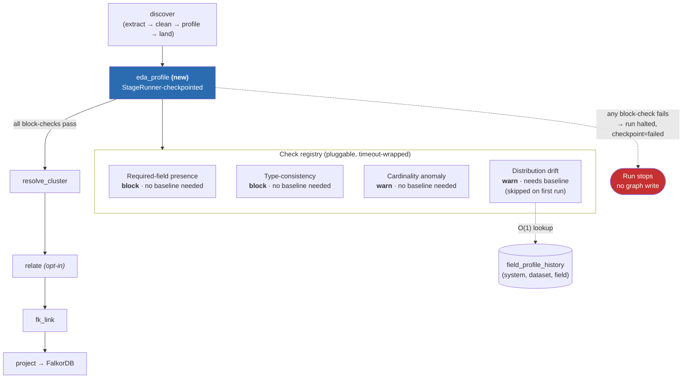

# Plan — EDA/Profiling Gate Before the Graph

Andie session — 🎭 Drama mode — 2026-08-28
Panel: Ravi (Data Governance Lead) · Kelsey (Pipeline/Orchestration Engineer) · Meera (Profiling/Stats Engineer) · Andres (Anarchist) · Omar (Saboteur)

Status: **planned** — not yet implemented.

---

## Context

`run_pipeline` (`src/aryx/pipeline/orchestrate.py`) chains: `discover` (extract → clean → profile → land) → `resolve_cluster` → `relate` → `fk_link` → `project` (FalkorDB). Profiling already exists (`src/aryx/pipeline/profile.py`, `ProfileAccumulator`) but is minimal — non-null count, distinct count (capped at 10k), and up to 5 samples per field. It feeds the LLM tagging stage; it is not a quality gate. Nothing today stops structurally broken or drifted data from reaching `resolve_cluster` and, eventually, the graph.

The ask: independent EDA/data-profiling checks that run before the graph, catching bad data early.

---

## Decision: one `eda_profile` stage with a pluggable check registry — not separate agent processes

"Independent" means independently addable/removable **checks**, each a small class behind one interface, running in-process inside a single new `StageRunner` stage between `discover` and `resolve_cluster`. Not distributed agents or services — the codebase has no current scale need for that, and it would add operational ceremony (deployment, IPC, failure isolation) without a corresponding benefit.

### Rejected alternatives
- **Separate agent processes/services per check** — ops overhead (deployment, IPC, partial-failure handling) with no scale justification today.
- **Advisory-only, never blocking** — silently lets structurally broken data reach entity resolution; the whole point is a gate.
- **Drift detection via full-table re-scan against prior data** — violates the memory-bounded design `ProfileAccumulator` was explicitly built for (see its docstring: "slows at TB scale" vs. "crashes at TB scale").

---

## Check Interface

```python
class ProfileCheck(Protocol):
    name: str
    severity: Literal["block", "warn"]
    timeout_s: float

    def run(self, profile: list[FieldProfile]) -> CheckResult: ...
```

Every check runs under a timeout/skip wrapper — a slow or hanging check degrades to `skipped` + flagged in run metadata, it never stalls `discover`. This was Omar's condition for accepting drift detection at all.

### Checks, v1

| Check | Severity | Needs baseline? |
|---|---|---|
| Required-field presence | block | no |
| Type-consistency (per-field value type stable) | block | no |
| Cardinality anomaly (e.g. near-100% distinct on a field that was low-cardinality) | warn | no |
| Distribution drift vs. last run's profile | warn | **yes** — cold-start: skipped until a baseline exists for that (system, dataset, field) |

Structural checks (presence, type-consistency) block from the very first run — there's no baseline needed to know a required field is missing. Distribution/drift checks are advisory-only until a baseline exists, then follow their configured severity.

---

## Drift Storage: summary compare, not raw scan

New table `field_profile_history` keyed by `(system, dataset, field)`, storing the last `FieldProfile` summary (non_null, distinct, distinct_capped) per field. Drift check does an O(1) lookup against this row — not a re-scan of prior records. This is what defused Omar's "Friday 5pm, 50GB file, drift check hangs `discover`" scenario in review.

---

## Wiring

- New stage `eda_profile` registered in `StageRunner`/`run_pipeline`, positioned after `discover` lands records and before `resolve_cluster` starts.
- On any `block`-severity check failing: stage fails via the existing `runner.stage(...)` exception path (same mechanism `resolve_cluster`/`relate`/`project` already use) — the run halts, checkpoint records `failed`, no graph write happens.
- On `warn`-severity results: attach to run metadata (the same `detail` dict pattern used by `tracker.finish(run_id, name, detail)` elsewhere), surfaced wherever run metadata is already shown — no new UI surface required for v1.
- Bypass path for false-positive blocks: mirror the existing `[GUARD:ALLOW-DELETE]` commit-flag pattern from `CLAUDE.md` — an explicit, logged override, not a silent skip.

---

## Action Plan

1. **Kelsey** — Define `ProfileCheck` protocol + timeout/skip wrapper; wire `eda_profile` stage into `orchestrate.py` / `StageRunner`.
2. **Meera** — Implement the four v1 checks; extend `FieldProfile`/`ProfileAccumulator` output as needed to support type-consistency and cardinality-anomaly checks.
3. **Meera** — New migration: `field_profile_history` table + read/write helper (O(1) baseline lookup, not a scan).
4. **Ravi** — Write the severity policy doc: exactly what blocks vs. warns, and the cold-start behavior for drift on a dataset's first run.
5. **Kelsey** — Wire the bypass-flag path for false-positive blocks.

## Risks

- **Cold-start blindness**: no drift signal until a second run exists for a given (system, dataset). Accepted — structural checks still cover run one.
- **New migration required** for `field_profile_history` — route through `db-specialist` before merge.
- **False-positive blocks** on structural checks need the bypass path shipped in the same PR, not as a follow-up, or teams will route around the gate entirely.

## Handoff

- Migration (`field_profile_history`) → `db-specialist`
- Stage wiring + checks → direct implementation against this plan

---

## Diagram



**Reading it:** `eda_profile` sits as a hard gate between `discover` and `resolve_cluster`. Structural checks (presence, type-consistency) can block on run one — no history needed. Drift needs `field_profile_history` and stays silent until a baseline exists. A `warn` never stops the pipeline; a `block` halts it before any entity resolution or graph write happens.

