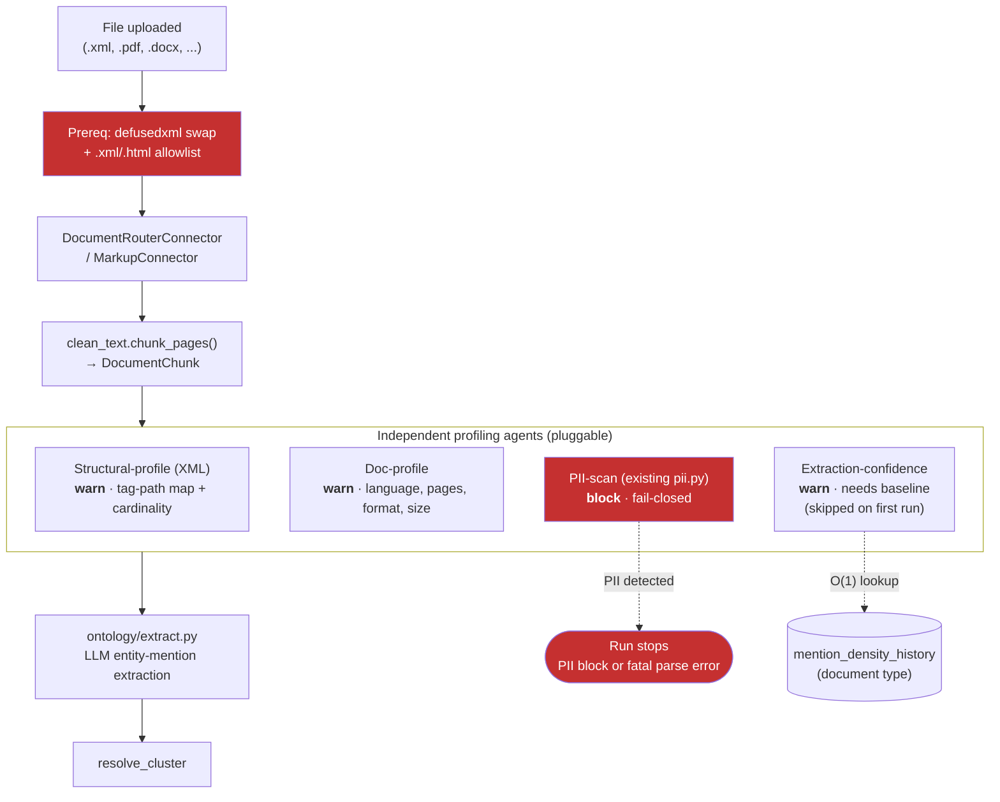

# Plan — EDA/Profiling Agents for Unstructured & XML Data

Andie session — 🎭 Drama mode — 2026-08-28
Panel: Fatima (Document Intelligence Lead) · Kenji (Unstructured Ingestion Engineer) · Aisha (NLP/Extraction Engineer) · Devon (Anarchist) · Mikko (Saboteur)

Status: **planned** — not yet implemented. Companion to [`plan_eda_profiling_gate.md`](./plan_eda_profiling_gate.md) (the tabular/structured-data gate); this plan covers the document/XML side of ingestion.

---

## Context

The tabular gate plan assumed structured `CleanRecord` payloads. Unstructured and XML content take a different path entirely:

- **Documents** (`.pdf`, `.docx`, etc.) route through `DocumentRouterConnector` → `clean_text.py`'s `chunk_pages()` → `DocumentChunk` (plain text + page/char offsets) → `pii.py` (Presidio scan) → `ontology/extract.py` (LLM entity-mention extraction with verbatim-span grounding).
- **XML** has a connector — `src/aryx/connectors/markup.py`, `_extract_xml()` — but it is currently **unreachable**: `.xml`/`.html` are absent from the extension allowlists in both `doc_discovery.py` (`DOC_EXTS`/`DATA_EXTS`) and `file_ingest_api.py` (`_DATA_EXTS`/`_DOC_EXTS`). Dead code today.
- When `markup.py` does run, `_extract_xml()` parses via stdlib `xml.etree.ElementTree` and flattens every element into `"tag: text"` / `"tag.attr: val"` lines — **the tree structure (nesting, tag vocabulary, cardinality) is discarded**, and it falls back to regex tag-stripping on parse error.
- `models.py` has no nested/hierarchical content model — only flat `payload: dict[str, Any]` (tabular) and flat `DocumentChunk.text` (unstructured). XML's structure has nowhere to land even if extracted.

No agent today gates on extraction quality: a document that produces zero grounded entity mentions proceeds through the pipeline silently, same as one that produces a hundred.

---

## Decision: harden + connect first, then four independent profiling agents

Two prerequisites block everything else and must ship first, together:

1. **`xml.etree.ElementTree` → `defusedxml.ElementTree`** in `markup.py`. Stdlib `ElementTree` has no built-in guard against entity-expansion bombs ("billion laughs") or external entity/DTD resolution (XXE) — a real, exploitable gap in a parser that accepts arbitrary uploaded files, not a hypothetical hardening exercise. `defusedxml` mirrors the stdlib API; only the import changes, `_extract_xml()`'s logic is untouched.
2. **Wire `.xml`/`.html` into the allowlists** in `doc_discovery.py` and `file_ingest_api.py` so `markup.py` becomes reachable at all.

Only once both land: four independent, pluggable profiling agents, mirroring the tabular plan's "stage with a check registry" shape rather than one monolithic parser.

| Agent | Extracts | Severity | Owner |
|---|---|---|---|
| **Structural-profile** (XML) | Tag-path → value/attrs map + per-path cardinality, from a single tree walk in `markup.py` (tag vocabulary logged for future use, **not** used for ontology-type inference in v1 — that's a deferred idea, not this plan) | warn | Kenji |
| **Doc-profile** | Language, page/element count, format, byte size — per document, before chunking | warn | Fatima |
| **PII-scan** | Reuses existing `pii.py` (`screen_chunks()`); wired into the same gate sequence, not rebuilt | block (existing fail-closed behavior) | Aisha |
| **Extraction-confidence** | Wraps `ontology/extract.py`; flags when grounded-mention density falls far below the historical baseline for that document type — not an absolute zero-mentions floor, which would false-flag legitimately sparse documents (e.g. a one-line memo) | warn (cold-start: skipped until a baseline exists, same pattern as tabular drift) | Aisha |

### Rejected alternatives
- **One parser doing structure + PII + extraction in a single pass** — couples concerns that evolve independently (a PII policy change shouldn't touch XML tree-walking code).
- **Tag-vocabulary → ontology-type inference in v1** — genuinely useful (`<Invoice><LineItem>` implies a type before any LLM call), but scope creep for a profiling plan; proposed as v2.
- **Absolute zero-grounded-mentions check** — flags legitimately sparse but valid documents; a baseline-relative threshold (mirroring `field_profile_history`) avoids this.

---

## Action Plan

1. **Mikko** — Swap `xml.etree.ElementTree` for `defusedxml.ElementTree` in `markup.py`; add a regression test with a billion-laughs / external-entity payload.
2. **Kenji** — Add `.xml`/`.html` to `DOC_EXTS`/`DATA_EXTS` in `doc_discovery.py` and `_DATA_EXTS`/`_DOC_EXTS` in `file_ingest_api.py`. **Must not land before item 1.**
3. **Kenji** — Structural-profile agent: extend `_extract_xml()` to also emit a `{tag_path: {values, attrs, count}}` structure alongside the existing flattened text output (flattener output unchanged, so nothing downstream breaks).
4. **Fatima** — Doc-profile agent: language/page-count/format/size metadata, attached to run metadata the same way tabular `warn` results are.
5. **Aisha** — Wire `pii.py`'s existing scan into the same gate sequence as the new agents (no new PII logic).
6. **Aisha** — Extraction-confidence agent: baseline table (document type → historical grounded-mention density), same O(1)-lookup shape as `field_profile_history`; wraps `ontology/extract.py` with a timeout/skip, since an LLM call now sits on a gate's critical path.

## Risks

- **Sequencing risk**: wiring `.xml` reachability before the `defusedxml` swap reopens an XXE/entity-expansion gap on a now-reachable parser — worse than today's dead-code state. Items 1 and 2 must ship in the same change.
- **Cold-start blindness**: extraction-confidence baseline has no signal until history accumulates for a document type — same accepted tradeoff as the tabular drift check.
- **Latency on the gate**: `ontology/extract.py` LLM calls are not free — needs the same timeout/skip discipline as the tabular checks, or a slow LLM call stalls ingestion.

## Handoff

- Parser hardening (`defusedxml` swap) + allowlist wiring → direct implementation, security-reviewed given the XXE angle
- Structural-profile / doc-profile / extraction-confidence agents → direct implementation against this plan
- Baseline history table → `db-specialist`

---

## Diagram

**Reading it:** nothing reaches `MarkupConnector` until the parser is hardened and the extension is wired in — that ordering is load-bearing, not incidental. PII-scan is the only hard block (existing fail-closed behavior); everything else is advisory and baseline-gated the same way the tabular drift check is.
